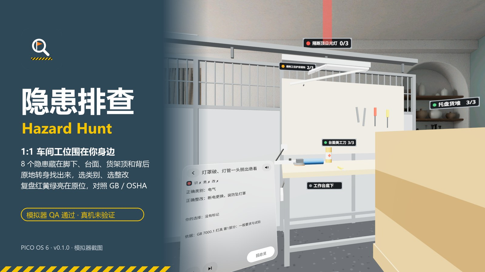
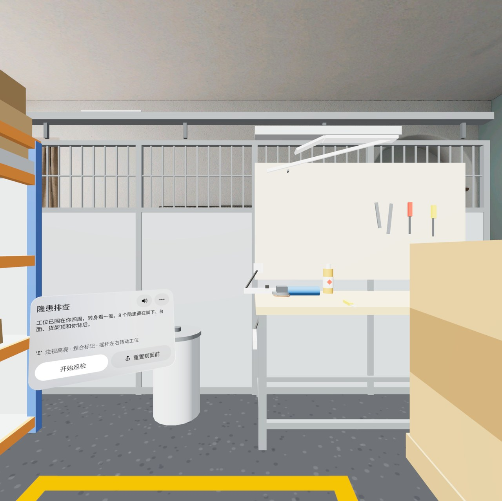
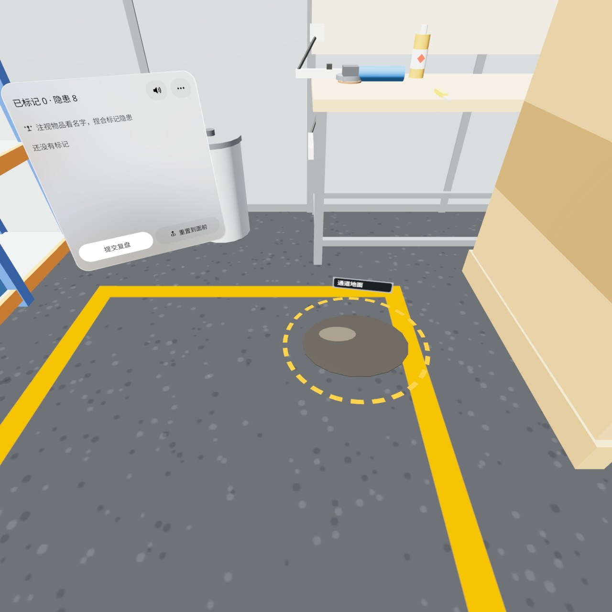
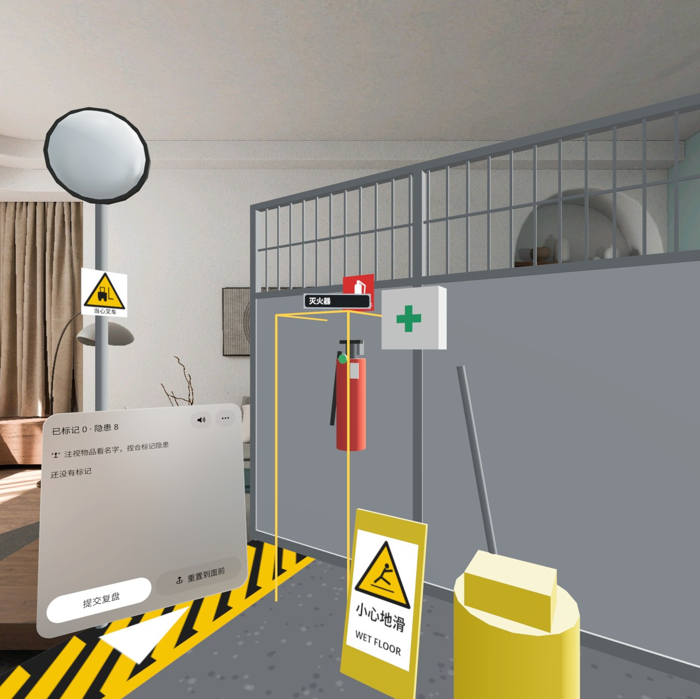
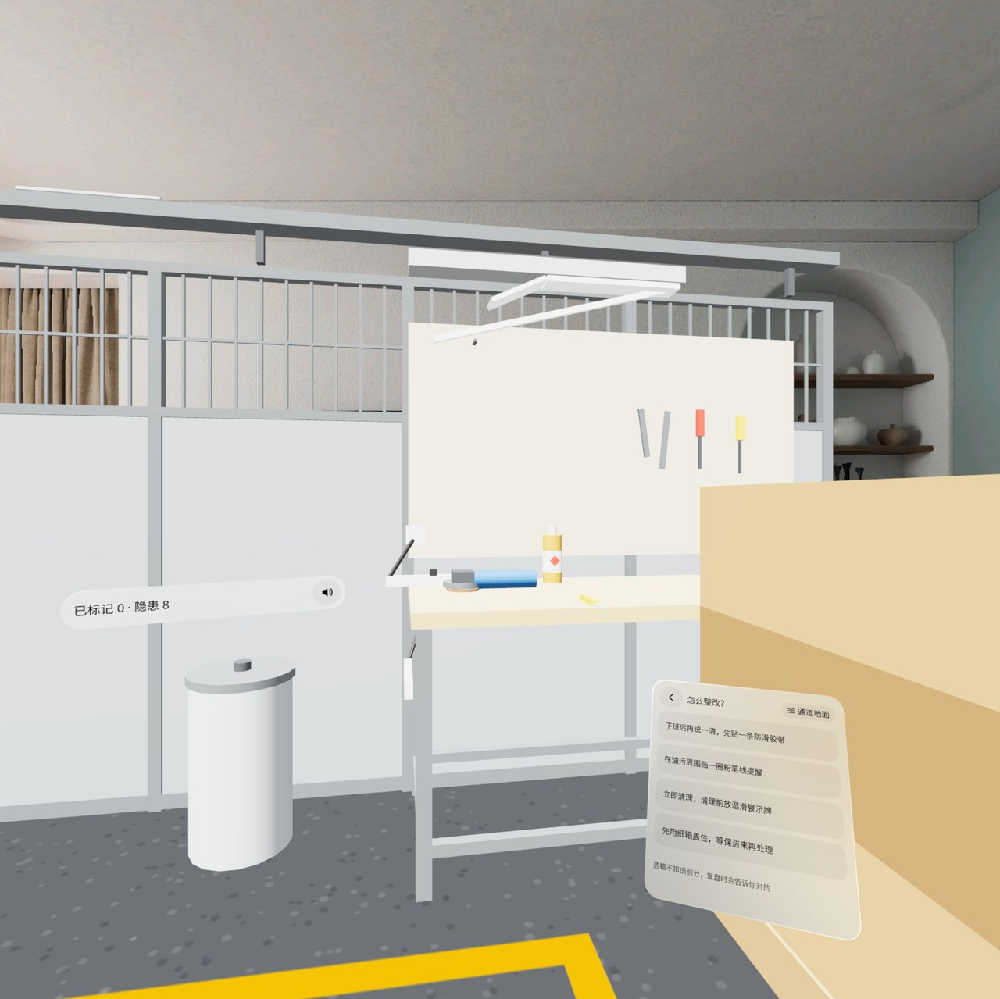
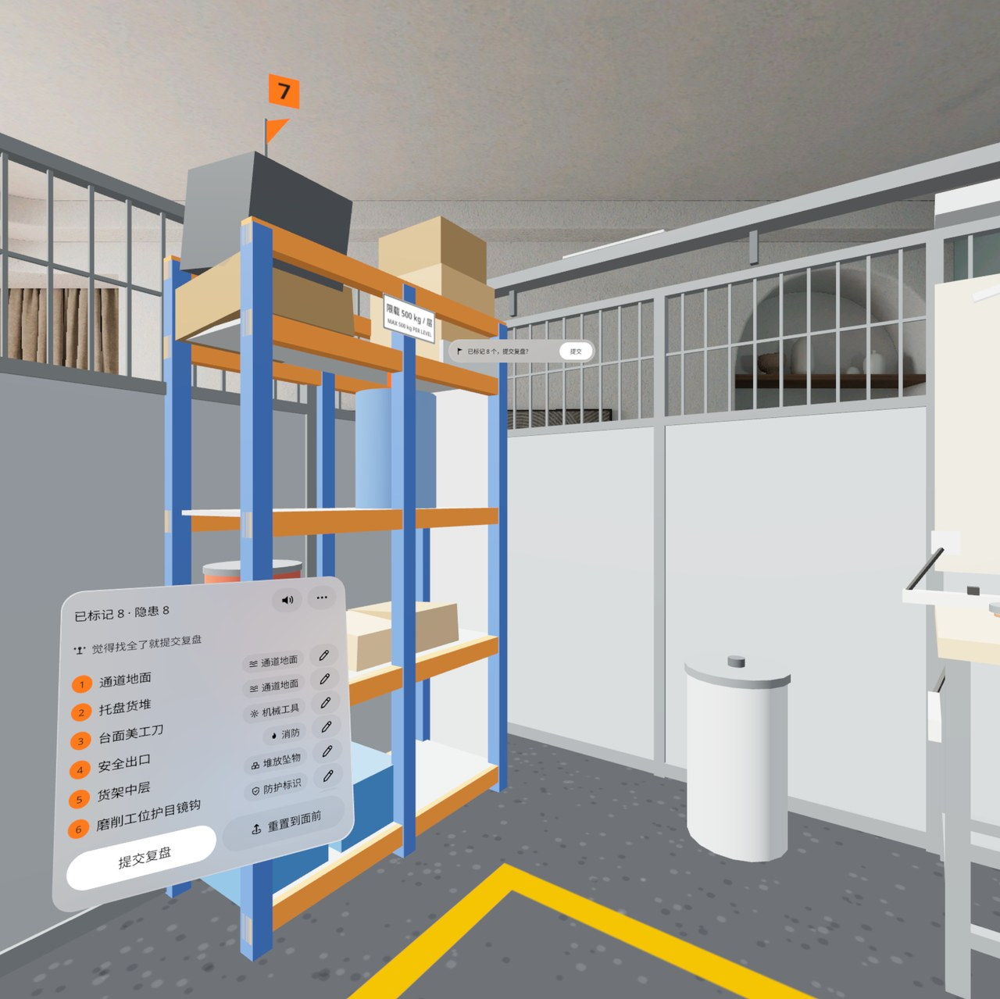
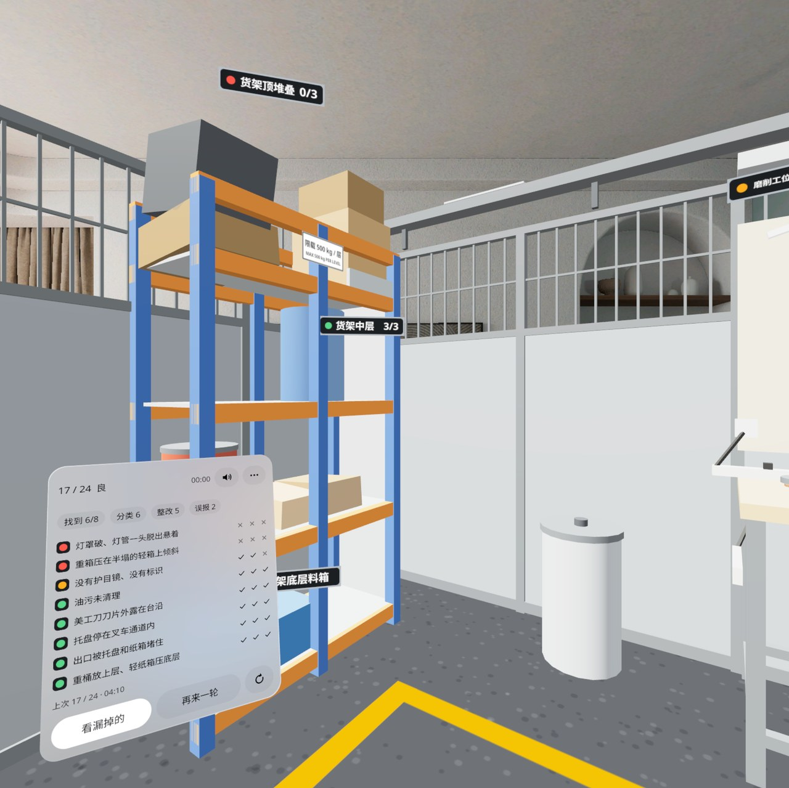
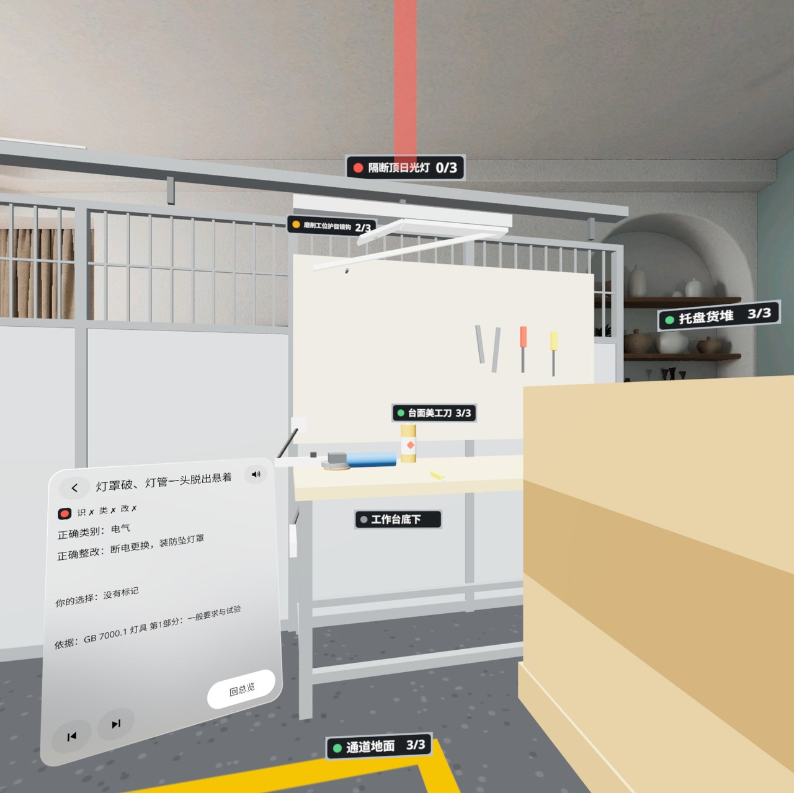

# 隐患排查 Hazard Hunt

> **v0.1.0 · 预发布 · 模拟器 QA 通过，真机未验证**（Pre-release · passed emulator QA, not yet verified on a headset）



[中文](#中文) · [English](#english)

---

## 中文

一个 1:1 的车间工位围在你身边：工作台在前、货架在左、托盘和气瓶在右、安全门在背后。PICO OS 6 混合现实应用，8 个隐患随机藏在**脚下、台面、货架顶和你背后**——原地转身、低头、抬头把它们找出来，注视高亮、捏合（或扳机）标记，再选「这是哪类隐患」和「怎么整改」；提交后复盘，每个隐患在原位亮红 / 黄 / 绿色标，并给出 GB / OSHA 依据。

- **28 个检查点**：每轮从 26 个常规点里抽 8 个显示隐患版（每个方向至少 1 个、低位和高位各至少 2 个、同类最多 2 个），其余显示安全版当干扰；同一种子可重玩
- **三项打分**：找到 1 分 + 分类对 1 分 + 整改对 1 分，满分 24；优 ≥ 21、良 ≥ 16；标了安全的地方算误报，不扣分
- **两步分类卡**：贴在被标记物品旁边，7 个类别（电气 · 化学品 · 机械工具 · 通道地面 · 消防 · 堆放坠物 · 防护标识），4 个整改选项每轮打乱
- **复盘**：红（漏掉）黄（有错）绿（全对）灰（误报）色标亮在原位；点一行或「看漏掉的」，工位转到它正对你，红色光束指着它，写出正确类别、正确整改、你的选择和依据
- **不用走动**：手柄摇杆左右整体转动工位（45° 一步）；「重置到面前」按当前朝向重新围好；可选「走动巡检」（默认关）多 2 个要走过去才看得到的隐患
- 主面板懒跟随在视野左下；静音键在面板首行（记住设置）；地面高度可调；中英双语；不联网、不需要账号

### 截图（模拟器，中文界面）

| | |
|---|---|
|  工位围在四周，左下是巡检面板 |  低头看脚下：地面油污亮起虚线环和名签 |
|  转身看背后：灭火器、急救箱、拖把桶 |  标记后两步分类：类别 → 整改 |
|  标满 8 个，提示提交复盘 |  复盘 17 / 24 良，红黄绿色标在原位 |



截图都来自 PICO 模拟器（High Definition 2560），状态用调试广播定住拍摄。演示视频（Release 附件 `video-01.mp4`，1080p）是模拟器上由调试输入驱动的演示，**非真实手势录像**，无声。道具是程序化白模（单位立方体 / 圆柱 / 球体拼出，标识自绘）。

### 安装

```bash
adb install -r HazardHunt-v0.1.0.apk
pico-cli app launch io.embodit.hazardhunt
```

APK 在 [Release v0.1.0](https://github.com/kejing-dev/HazardHunt/releases/tag/v0.1.0)（debug 构建，sha256 `18b100b900c738ca63d9911a9bcf945877da5a121fa4c602745277125f6ad939`）。需要 PICO OS 6（Spatial SDK 6.1.9，minSdk 35），只在 Full Space（Mixed Stage，透视）运行。

### 真机未验证

模拟器上过了三道门禁（无 Material 组件；冷启动 3 × 60 秒无崩溃 / ANR；设计包 32 个状态组合全部截图核对，另用真实相机转身、低头、走动补测）。下面这些只有戴上头显才能确认：

- 实体手柄摇杆的 45° 步进手感（模拟器报手柄不可用，只验了同一段转动代码）
- 眼动注视 + 捏合、手柄射线 + 扳机在检查点上的命中
- 声音（标记「叮」、复盘和弦）是否出声、音量
- 真实房间的地板识别（模拟器 FLOOR y = 0.40 贴合；识别不到用头高 − 1.60 m 兜底）
- 透视画面下玻璃面板的对比度

### 已知问题（不挡用）

1. 走动巡检里 P26（工作台右半台面）按设计的观察点 (1.0, −0.6) 看不到，被托盘堆挡住；走动巡检默认关。
2. 走动巡检里贴近托盘时，没有做「走进物体变半透明」。
3. 没有手柄位姿时，名签悬停用头部朝向兜底，面板上没有单独提示（选择只认捏合 / 扳机落点）。
4. 相邻检查点的指针盒会互抢（如对准灭火器中心先亮拖把桶），偏 5–8° 都能点亮。
5. 首次引导气泡和提示条的字偏小，真机上要看可读性。
6. 复盘的 ↻ 是「重玩这轮」（同一种子重来），和设计稿「重玩上一轮」不同，待确认。
7. 「通道地面」检查点和类别 chip 同名，有点泄题。
8. 托盘货堆最近的角离人 0.85 米，平视占画面右侧一块。

### 开发

Kotlin · PICO Spatial SDK 6.1.9 · 一个 Mixed Stage。结构、调试广播、截图脚本见 [AGENTS.md](AGENTS.md)。字体 Noto Sans / Noto Sans SC（SIL OFL 1.1，见 `third_party/`）；音效用系统音。

---

## English

A life-size workshop bay wraps around you: bench ahead, rack on the left, pallets and a gas cylinder on the right, the safety door behind. A PICO OS 6 mixed-reality app: eight random hazards hide **at your feet, on the bench, up on the rack and behind your back**. Turn in place, look down and up, gaze to highlight, pinch (or pull the trigger) to flag, then pick the hazard type and the fix. The debrief lights every hazard red / yellow / green in place with a GB / OSHA teaching note.

- **28 checkpoints**: each round draws 8 of 26 regular checkpoints as hazards (every direction at least once, at least two low and two high, at most two of one type); the others show their safe version as distractors; a round can be replayed from its seed
- **Three points per hazard**: found + right type + right fix, 24 in all; Excellent ≥ 21, Good ≥ 16; flags on safe items are false alarms and cost nothing
- **Two-step card** beside the flagged item: 7 types (Electrical · Chemical · Machines · Floor · Fire · Storage · Signs/PPE), 4 fixes shuffled each round
- **Debrief**: red (missed), yellow (a mistake), green (all right), grey (false alarm) tags in place; open a row or "Show missed" and the bay turns it in front of you with a red beam, the right type and fix, your pick and the basis
- **No walking needed**: the thumbstick turns the whole bay in 45° steps; "Recenter" rebuilds it around your current heading; optional walk mode (off by default) adds two hazards you must walk to
- The main panel lazily follows at the lower left of your view; mute on its first row (remembered); floor height adjustable; Chinese and English; offline, no account

### Screenshots

See the table above (Chinese UI on the PICO emulator, High Definition 2560, states pinned with debug broadcasts). The demo video in the release (`video-01.mp4`, 1080p) is driven by debug input on the emulator — **not a recording of real hand gestures** — and has no sound. Props are procedural white-box models (scaled cubes / cylinders / spheres, self-drawn signs).

### Install

```bash
adb install -r HazardHunt-v0.1.0.apk
pico-cli app launch io.embodit.hazardhunt
```

The APK is in [Release v0.1.0](https://github.com/kejing-dev/HazardHunt/releases/tag/v0.1.0) (debug build, sha256 `18b100b900c738ca63d9911a9bcf945877da5a121fa4c602745277125f6ad939`). Needs PICO OS 6 (Spatial SDK 6.1.9, minSdk 35); runs in Full Space only (Mixed Stage, passthrough).

### Not yet verified on a headset

Passed three emulator gates (no Material components; three 60 s cold starts without crash / ANR; all 32 design state combinations captured and checked, plus real camera turns, look-down and walking). Only a headset can confirm:

- the feel of 45° steps on a physical thumbstick (the emulator reports no controller; the same turn code was exercised)
- eye gaze + pinch and controller ray + trigger hitting the checkpoints
- sound output and volume
- floor detection in a real room (emulator FLOOR y = 0.40 matched; fallback = eye height − 1.60 m)
- glass panel contrast over passthrough

### Known issues (not blocking)

1. In walk mode, checkpoint P26 (bench right side) is hidden by the pallet stack from the design's viewpoint (1.0, −0.6); walk mode is off by default.
2. Walking into a prop in walk mode does not make it translucent yet.
3. Without a controller pose, hover tags fall back to head direction with no separate on-panel hint (selection only uses the pinch / trigger hit).
4. Neighbouring checkpoint boxes can win over each other (aiming at the extinguisher's centre lights the mop bucket first); 5–8° off works.
5. The first-run coach bubble and snackbar text are small; readability needs a headset check.
6. The debrief's ↻ replays this round (same seed), not the previous round as in the design; to be confirmed.
7. The "Walkway floor" checkpoint shares its name with the "Floor" type chip.
8. The nearest pallet corner is 0.85 m away and fills part of the right side of the view.

### Development

Kotlin · PICO Spatial SDK 6.1.9 · one Mixed Stage. Structure, debug broadcasts and capture scripts: [AGENTS.md](AGENTS.md). Fonts Noto Sans / Noto Sans SC (SIL OFL 1.1, see `third_party/`); sounds are system sounds.
